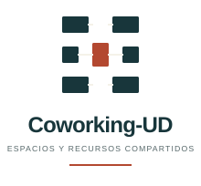

<p align="center">
  
</p>

<p align="center">
  
</p>

<p align="center">
  <a href="https://git.io/typing-svg"></a>
</p>

<p align="center">
  
  
  
  
</p>

<p align="center">
  
  
  
  
</p>

> Frontend del sistema integral de espacios y recursos compartidos de la Universidad Distrital

Aplicación creada con Next.js App Router, React, TypeScript y Tailwind CSS. El repositorio se encuentra en preparación: todavía no contiene funcionalidad del dominio.

## Stack

- **Framework:** Next.js 16.4.6 con App Router y Turbopack.
- **UI:** React 19.3.0 y Tailwind CSS 4.3.3.
- **Tipado:** TypeScript en modo estricto.
- **Calidad inicial:** ESLint, TypeScript y build de producción.
- **Gestor:** pnpm 11.22.0 mediante Corepack.
- **Runtime:** Node.js 24.16.0.

## Inicio rápido

Instala las dependencias:

```bash
corepack pnpm install
```

Inicia el servidor de desarrollo:

```bash
corepack pnpm dev
```

Abre [http://localhost:3000](http://localhost:3000) en el navegador.

## Comandos

```bash
corepack pnpm dev
corepack pnpm lint
corepack pnpm exec tsc --noEmit
corepack pnpm build
corepack pnpm start
```

## Estructura

- `src/app/`: rutas, layout y tokens globales de la aplicación.
- `src/components/ui/`: primitivas de botones, campos y tarjetas.
- `src/components/shared/`: estados compartidos, badges y selector de tema.
- `public/brand/`: logotipos y favicon oficiales del manual de marca.
- `docs/adr/`: decisiones de arquitectura.
- `docs/assets/`: recursos usados por la documentación.
- `.github/workflows/`: validación continua del repositorio.

## Flujo de trabajo

1. Crea una rama corta `feat/...`, `fix/...` o `chore/...` desde `main`.
2. Mantén cada PR limitada a un issue o flujo.
3. Exige una aprobación de la otra persona del equipo y CI en verde.
4. Integra mediante merge commit, sin squash, rebase ni force-push sobre trabajo publicado.

## Documentación

- [ADR 001 — BFF, mocks y caché](docs/adr/001-bff-mocks-cache.md).
- [Flujo de trabajo y decisiones pendientes del contrato](docs/CONTRATO-DECISIONES.md).

El contrato funcional de backend se mantiene fuera de este repositorio, en `../coworking-docs/CONTRATO-BACKEND.md`, con su OpenAPI en `../coworking-docs/openapi/openapi.yaml`.

## Estado actual

- Base visual con tokens La Planta Común, fuentes autoalojadas y modo claro/oscuro.
- Primitivas accesibles y estados compartidos de carga, vacío, error y éxito.
- CI inicial para instalación, lint, typegen, typecheck y build.
- Sin módulos de negocio, integración HTTP, Docker ni despliegue configurado.

## Autor

**GLUD — Grupo GNU/Linux de la Universidad Distrital**

Universidad Distrital Francisco José de Caldas

Proyecto desarrollado para Bases de Datos, 2026-3.

## Licencia

Este proyecto se distribuye bajo la licencia MIT. Consulta [LICENSE](LICENSE).

<p align="center">
  
</p>
